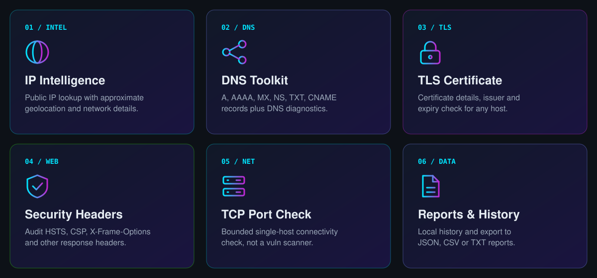
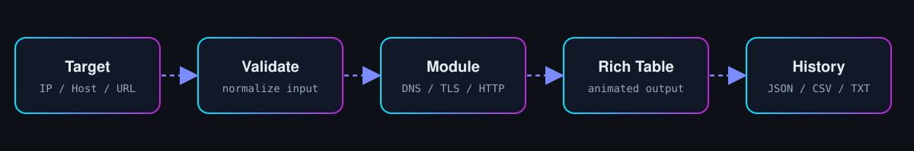

<div align="center">


<br/>


### A Termux-friendly OSINT & network intelligence toolkit
**14 modules • Animated Rich terminal UI • Local history • JSON / CSV / TXT reports**

[**Features**](#-features) &nbsp;•&nbsp; [**Preview**](#-live-preview) &nbsp;•&nbsp; [**Install**](#-installation) &nbsp;•&nbsp; [**Modules**](#-modules) &nbsp;•&nbsp; [**FAQ**](#-faq) &nbsp;•&nbsp; [**Responsible Use**](#%EF%B8%8F-responsible-use)

</div>


## 🎬 Live Preview

<div align="center">

</div>


## ✨ Features

<div align="center">

</div>

- 🎨 **Rich terminal UI** with animated status spinners, rounded tables and a plain-text fallback
- ⚡ **Lightweight**: only three dependencies (`requests`, `dnspython`, `rich`)
- 📱 **Built for Termux**, also runs on Linux and Windows
- 🗂️ **Local history** and one-click report export
- 🧪 **Input validation** on every target (IPs, hosts, URLs, ports)
- 🔕 `NO_COLOR=1` support for clean logs


## 🧩 How It Works

<div align="center">

</div>


## 🚀 Installation

<details open>
<summary><b>📱 Termux (Android)</b></summary>

```bash
pkg update && pkg upgrade -y
pkg install python git -y

git clone https://github.com/darkvibez456/vibetrackosint
cd vibetrackosint

pip install -r requirements.txt
python vibetrackosint.py
```
</details>

<details>
<summary><b>🐧 Linux</b></summary>

```bash
git clone https://github.com/darkvibez456/vibetrackosint
cd vibetrackosint

python3 -m pip install -r requirements.txt
python3 vibetrackosint.py
```
</details>

<details>
<summary><b>🪟 Windows</b></summary>

```powershell
git clone https://github.com/darkvibez456/vibetrackosint
cd vibetrackosint

py -m pip install -r requirements.txt
py vibetrackosint.py
```
</details>


## 🧰 Modules

| No. | Module | What it does |
|:---:|---|---|
| `1` | **IP Intelligence Lookup** | Public IP info with approximate geolocation |
| `2` | **Website Status Check** | Status code and response time |
| `3` | **DNS Record Lookup** | A / AAAA, MX, NS, TXT, CNAME |
| `4` | **TCP Port Check** | Limited port list on a single host |
| `5` | **SSL/TLS Certificate Check** | Certificate details and expiry |
| `6` | **HTTP Response Headers** | Full header inspection |
| `7` | **Security Headers Audit** | HSTS, CSP, X-Frame-Options, and more |
| `8` | **Domain RDAP Lookup** | WHOIS-style registration data |
| `9` | **IP & Subnet Calculator** | IP / CIDR network details |
| `10` | **Admin Panel Finder** | Bounded common-path check on one authorized site |
| `11` | **Network DNS Diagnostics** | Resolution checks |
| `12` | **User-Agent Generator** | Random UA strings |
| `13` | **Scan History** | View local history |
| `14` | **Export Reports** | JSON / CSV / TXT |


## 🎮 Usage

```bash
python vibetrackosint.py          # start the interactive menu
NO_COLOR=1 python vibetrackosint.py   # disable colors
python -m unittest discover tests     # run tests
```

Pick a module number, enter your target, and results appear in formatted tables and are saved to local history.

## 📁 Project Structure

```text
vibetrackosint/
├── assets/              # banner, preview and design images
├── tests/
│   └── test_core.py     # validation tests
├── vibetrackosint.py    # main application
├── requirements.txt
├── CHANGELOG.md
├── CONTRIBUTING.md
├── LICENSE
└── README.md
```

## 🎨 Design Palette

| Color | Hex | Use |
|---|---|---|
|  Midnight | `#0D1117` | Background |
|  Cyber Cyan | `#00E5FF` | Primary |
|  Neon Purple | `#C026D3` | Accent |
|  Terminal Green | `#39FF14` | Success |
|  Warning Amber | `#FFBD2E` | Warnings |


## ❓ FAQ

<details>
<summary><b>Does it work without Rich installed?</b></summary>
Yes. It falls back to plain text output automatically.
</details>

<details>
<summary><b>Where is my data stored?</b></summary>
Only locally, in <code>ip_recon_history.json</code> in the folder you run it from. Nothing is uploaded anywhere by the tool itself.
</details>

<details>
<summary><b>Is the port checker a vulnerability scanner?</b></summary>
No. It is a basic TCP connectivity check on a limited port list.
</details>

<details>
<summary><b>How accurate is IP geolocation?</b></summary>
Approximate only (usually city or region level). Never use it to identify a person's exact location.
</details>

## 🗺️ Roadmap

- [x] Rich animated terminal UI
- [x] Report export (JSON / CSV / TXT)
- [x] Unit tests for input validation
- [ ] Real screenshots in `assets/`
- [ ] More tests for network modules
- [ ] Packaging for `pip install`

## ⚠️ Responsible Use

> **Use only on systems you own or have explicit written permission to assess.**

- The tool shows warnings but does **not** grant authorization.
- The Admin Panel Finder checks a bounded list of common paths on **one** specified website. It does **not** guess passwords, bypass authentication, or exploit vulnerabilities. Review responses manually.
- The TCP checker is a basic connectivity check, **not** a vulnerability scanner.
- Exported reports may contain sensitive data. Review them before sharing.

## 🤝 Contributing

Bug reports and pull requests are welcome. Keep the tool compatible with Python 3 and Termux. Do not add credential guessing, authentication bypass, exploitation, or stealth features. See [CONTRIBUTING.md](CONTRIBUTING.md).

## 📜 License

Released under the [MIT License](LICENSE).


<div align="center">

**Built with 💜 by [darkvibez456](https://github.com/darkvibez456)**

⭐ Star the repo if you find it useful!

</div>
